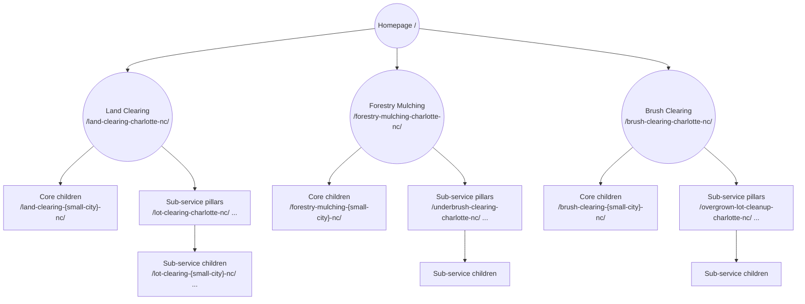
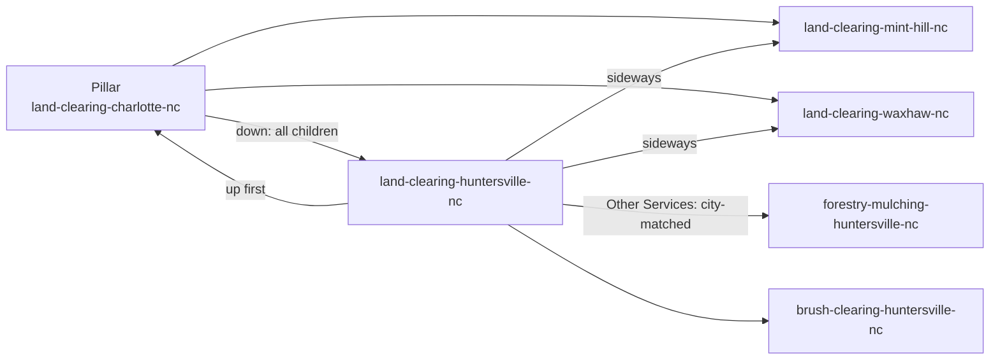

# Charlotte Land Clearing — Silo Structure

**Domain:** `landclearingcharlotte.com`
**Site type:** Local SEO lead generation
**Main city:** Charlotte, NC
**Primary phone:** `(828) 576-3931` (`tel:8285763931` · JSON-LD: `+1-828-576-3931`)
**Status:** Approved structure · v1.0 · October 2026

This document defines how every page on the site is named, organized, linked, and built. Any new page must follow these rules.

---

## 1. The model in one paragraph

The **homepage** links to **3 core service silos** (Land Clearing, Forestry Mulching, Brush Clearing). Each silo's top page is a **pillar** = *core service + main city + state*. Each pillar has **children**, which are the same service in surrounding **small cities**. Each silo also has **sub-services**, and every sub-service also gets a **main-city page** and **small-city pages**. Pillars and children share the **same page skeleton**. Pillars go deeper and link down to every child. Children stay tighter, link **up first**, then **sideways**, and have copy that is **100% unique to their town**.

---

## 2. URL rules

**One pattern for every service page on the site:**

```
/{service}-{city}-{state}/
```

| Rule | Example |
|---|---|
| Service first, then city, then 2-letter state | `/land-clearing-charlotte-nc/` |
| Lowercase, hyphens only, no folders | `/right-of-way-clearing-mint-hill-nc/` |
| Multi-word cities are hyphenated | `/brush-clearing-indian-trail-nc/` |
| The state matches the city's real state | `/land-clearing-fort-mill-sc/` |
| Trailing slash; each page is a folder with an `index.html` | `/land-clearing-charlotte-nc/index.html` |
| Never change a URL after it goes live (use a 301 redirect if you must) | — |

---

## 3. Page types

| Type | Formula | Example URL | Links up to |
|---|---|---|---|
| **Homepage** | Brand + overview of all 3 services | `/` | — |
| **Core pillar** | Core service + main city | `/land-clearing-charlotte-nc/` | Homepage |
| **Core child** | Core service + small city | `/land-clearing-huntersville-nc/` | Core pillar |
| **Sub-service pillar** | Sub-service + main city | `/lot-clearing-charlotte-nc/` | Core pillar of its silo |
| **Sub-service child** | Sub-service + small city | `/lot-clearing-huntersville-nc/` | Sub-service pillar |
| **Supporting** | Not location-based | `/lot-clearing-tips/`, `/privacy-policy/` | Homepage |

> [!NOTE]
> **Homepage vs. Land Clearing pillar:** the domain already contains "Charlotte land clearing," so the homepage acts as the **brand overview of all three services**. The deep content for "land clearing Charlotte NC" lives on `/land-clearing-charlotte-nc/`, and the homepage links to it prominently. This keeps the two pages from competing for the same keyword.

---

## 4. Silo map



---

## 5. Service inventory

Status key: ✅ confirmed · ⚠️ confirm before building

### Silo 1 — Land Clearing
**Pillar:** `/land-clearing-charlotte-nc/` · **Buyer:** wants to build on or use the land

| Sub-service | Slug | Status |
|---|---|---|
| Residential Lot Clearing | `lot-clearing` | ✅ |
| Acreage Clearing | `acreage-clearing` | ✅ |
| Commercial Land Clearing | `commercial-land-clearing` | ✅ |
| House Pad & Building Site Prep | `house-pad-site-prep` | ⚠️ grading? |
| Selective Clearing & Tree Preservation | `selective-clearing` | ✅ |
| Driveway & Access Road Clearing | `driveway-clearing` | ✅ |
| Clearing for Pools, Barns & Outbuildings | `outbuilding-site-clearing` | ✅ |
| Lakefront & Shoreline Lot Clearing | `lakefront-lot-clearing` | ⚠️ lake work? |
| Stump Grinding & Removal | `stump-grinding` | ⚠️ |

### Silo 2 — Forestry Mulching
**Pillar:** `/forestry-mulching-charlotte-nc/` · **Buyer:** wants land cleaned up and usable without burning, hauling, or soil damage

| Sub-service | Slug | Status |
|---|---|---|
| Underbrush Clearing | `underbrush-clearing` | ✅ |
| Pasture & Field Reclamation | `pasture-clearing` | ✅ |
| Trail Cutting | `trail-cutting` | ✅ |
| Hunting Land & Food Plot Clearing | `food-plot-clearing` | ✅ |
| Right-of-Way & Easement Clearing | `right-of-way-clearing` | ✅ |
| Survey Line Clearing | `survey-line-clearing` | ✅ |
| Woodland Thinning | `woodland-thinning` | ✅ |
| Firebreak & Fuel Reduction | `firebreak-clearing` | ✅ |

### Silo 3 — Brush Clearing
**Pillar:** `/brush-clearing-charlotte-nc/` · **Buyer:** wants overgrowth gone from a lot, edge, or problem area

| Sub-service | Slug | Status |
|---|---|---|
| Overgrown Lot Cleanup | `overgrown-lot-cleanup` | ✅ |
| Invasive Species Removal | `invasive-species-removal` | ⚠️ herbicide? |
| Kudzu & Vine Removal | `kudzu-removal` | ⚠️ herbicide? |
| Briar & Thicket Clearing | `briar-clearing` | ✅ |
| Fence Line & Property Line Clearing | `fence-line-clearing` | ✅ |
| Retention & Detention Pond Clearing | `retention-pond-clearing` | ✅ |
| Ditch & Drainage Clearing | `ditch-clearing` | ✅ |
| Storm Debris & Downed Tree Cleanup | `storm-debris-cleanup` | ⚠️ |

---

## 6. Service area (cities)

| Role | City | Slug |
|---|---|---|
| **Main city (pillars)** | Charlotte, NC | `charlotte-nc` |
| Wave 1 small city | Huntersville, NC | `huntersville-nc` |
| Wave 1 small city | Mint Hill, NC | `mint-hill-nc` |
| Wave 1 small city | Waxhaw, NC | `waxhaw-nc` |
| Wave 1 small city | Concord, NC | `concord-nc` |
| Wave 1 small city | Mooresville, NC | `mooresville-nc` |
| Wave 1 small city | Indian Trail, NC | `indian-trail-nc` |
| Wave 2 (future) | Matthews, Monroe, Harrisburg, Gastonia, Weddington, NC · Fort Mill, SC | `matthews-nc`, `monroe-nc`, `harrisburg-nc`, `gastonia-nc`, `weddington-nc`, `fort-mill-sc` |

**Rule for adding a city:** you genuinely serve it, there is search demand, and you have at least one local proof point (a project, photo, review, or terrain detail).

---

## 7. Page skeleton (shared by pillars and children)

Same skeleton, different depth.

| # | Section | Pillar (deeper) | Child (tighter, 100% unique copy) |
|---|---|---|---|
| 1 | **Title tag + meta** | `{Service} in {City}, {ST} \| Charlotte Land Clearing` | Same formula; the meta mentions a local landmark or drive time |
| 2 | **Hero (split)** | Left: H1 `{Service} in {City}, {ST}` + intro. Right: **estimate form above the fold** + call button | Same layout; intro written for the town |
| 3 | **Trust bar** | Rating · reviews · owner on every job · insured | Local version: "Trusted across {City} · ~{X} min from {landmark}" |
| 4 | **H2: What Our Process Is** | Intro + **4 numbered step cards** + supporting copy | Short process copy specific to the town |
| 5 | **H2: Where We Serve** | A card for **every child page**, with no limit | **First card = its pillar**, then sibling cities, no limit |
| 6 | Continuing copy | Depth on terrain, permits, equipment | Local terrain, soils, neighborhoods |
| 7 | **H2: Other Services We Provide in {City}** | Every silo, city-matched; the core page leads each group, sub-services follow | Same, city-matched to the town |
| 8 | **H2: Why Choose Us** | Full trust story | Town-specific angle |
| 9 | **H2: {City} {Service} FAQs** | 8–12 Q&As written out in full, unique per city | 8–12 Q&As unique to the town |

**Target length:** pillars 1,800–2,500 words · children 900–1,400 words
**Schema:** LocalBusiness (`areaServed` = page city), Service, FAQPage, BreadcrumbList

---

## 8. Internal link rules

1. **No internal links inside body copy.** All internal links live in cards and link sections (nav, hero CTA, Where We Serve, Other Services, footer).
2. **On every child page, the first in-content link is its pillar** (the first card in Where We Serve).
3. **Other Services is always city-matched.** A Huntersville page links only to Huntersville service pages, and the core service page leads each group.
4. **Where We Serve has no limit.** Every city in the service area gets a card.
5. **Proposed pages** (not yet built) show as unlinked cards, never as broken links. When the page goes live, the card becomes a link.

### Link map by page type

| Page | Links up (first) | Where We Serve (sideways or down) | Other Services in {City} |
|---|---|---|---|
| Core pillar `/land-clearing-charlotte-nc/` | Homepage (nav/breadcrumb) | All `/land-clearing-{small-city}/` children | Own silo's sub-services + other 2 silos, all Charlotte |
| Core child `/land-clearing-huntersville-nc/` | `/land-clearing-charlotte-nc/` | Other `/land-clearing-{small-city}/` siblings | All 3 silos, Huntersville versions |
| Sub-service pillar `/lot-clearing-charlotte-nc/` | `/land-clearing-charlotte-nc/` | All `/lot-clearing-{small-city}/` children | All 3 silos, Charlotte versions |
| Sub-service child `/lot-clearing-huntersville-nc/` | `/lot-clearing-charlotte-nc/` | Other `/lot-clearing-{small-city}/` siblings | All 3 silos, Huntersville versions |



---

## 9. Keyword ownership (one search phrase = one page)

| Search phrase | Owner |
|---|---|
| Brand / "Charlotte land clearing company" | Homepage |
| "land clearing Charlotte NC" | `/land-clearing-charlotte-nc/` |
| "forestry mulching Charlotte NC" | `/forestry-mulching-charlotte-nc/` |
| "brush clearing / brush removal Charlotte NC" | `/brush-clearing-charlotte-nc/` |
| "lot clearing Charlotte" | `/lot-clearing-charlotte-nc/` |
| "underbrush clearing" | Underbrush (Forestry silo), not Brush Clearing |
| "invasive removal" vs. "kudzu removal" | Shrubs and trees vs. vines; separate pages |
| "{service} {small city}" | The matching child page |

If two pages would answer the same question for the same person, merge them.

---

## 10. Page count

| | Charlotte (main) | × 6 Wave 1 cities | Total |
|---|---|---|---|
| Core services (3) | 3 | 18 | **21** |
| Sub-services (25) | 25 | 150 | **175** |
| **All service pages** | **28** | **168** | **196** |

## 11. Build phases

| Phase | Build | Pages |
|---|---|---|
| **1** | 3 core pillars + homepage nav and card updates | 3 |
| **2** | 3 core services × 6 Wave 1 cities | 18 |
| **3** | Charlotte sub-service pillars (✅ items first: Lot Clearing, Acreage, Underbrush, Right-of-Way, Overgrown Lot Cleanup, Commercial) | ~25 |
| **4** | Sub-service children, only where there's demand or local proof | Ongoing |
| **5** | Wave 2 cities | Ongoing |

## 12. Existing pages

| Page | Action |
|---|---|
| `/` (homepage) | Replace 6 service cards with 3 silo cards; add a "Services" dropdown; repoint `#estimate-form` service links to the pillars |
| `/lot-clearing-tips/` | Keep as the blog hub; articles link to the matching sub-service pillar (card-style "related service" block) |
| `/privacy-policy/`, `/cookies-policy/`, `/terms-and-conditions/` | Keep; footer only |

## 13. Pre-publish checklist (every page)

- [ ] URL follows `/{service}-{city}-{state}/`
- [ ] Title, meta, and H1 use the formula with the correct city
- [ ] Estimate form is above the fold
- [ ] The first in-content link is the correct parent (children only)
- [ ] Where We Serve lists every live sibling; proposed pages are unlinked
- [ ] Other Services is 100% city-matched
- [ ] No links inside body copy
- [ ] Copy is unique (not spun from another city), with at least 1 local proof point
- [ ] 8–12 unique FAQs + FAQPage schema
- [ ] Pillar updated to link to the new child
- [ ] Phone number matches canonical format: `(828) 576-3931` (visible), `tel:8285763931` (links), `+1-828-576-3931` (JSON-LD schema)
