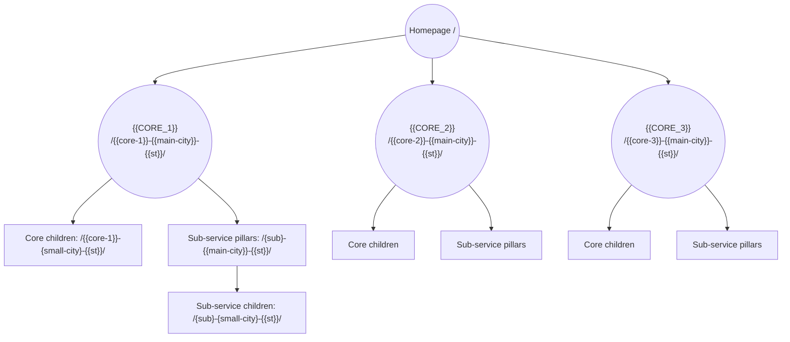

# Silo Structure Template — Local SEO Lead Generation Site

Use this template to plan the site structure for a **new local service business**. It follows the same model as the Charlotte Land Clearing silo structure (`charlotte-land-clearing-silo-structure.md`).

**How to use it:**
1. Fill out **Part A (Intake)**. Every `{{PLACEHOLDER}}` needs an answer.
2. Use your answers to fill out **Part B (Silo Structure)**. The rules in Part B never change; only the placeholders do.
3. Save the completed copy as `{{site-slug}}-silo-structure.md`.

---

# PART A — INTAKE QUESTIONNAIRE

## A1. Business basics

| Question | Answer |
|---|---|
| Business / brand name | `{{BRAND_NAME}}` |
| Domain | `{{DOMAIN}}` |
| Industry / trade | `{{INDUSTRY}}` |
| Primary phone | `{{PHONE}}` |
| Google Business Profile address (city) | `{{GBP_CITY}}` |
| Hours | `{{HOURS}}` |
| Licenses / insurance / certifications | `{{CREDENTIALS}}` |
| Owner or lead expert name (for E-E-A-T) | `{{EXPERT_NAME}}` |
| Languages spoken | `{{LANGUAGES}}` |
| Main conversion action (estimate, booking, call) | `{{CONVERSION_ACTION}}` |
| Where form leads are delivered (email / CRM) | `{{LEAD_DESTINATION}}` |

## A2. Main city

| Question | Answer |
|---|---|
| Main city (used on all pillar pages) | `{{MAIN_CITY}}` |
| State (2-letter) | `{{ST}}` |
| City tier (1 = large metro, 2 = mid city, 3 = small city) | `{{TIER}}` |
| Does the domain contain the main city + service? (yes/no) | `{{EXACT_MATCH_DOMAIN}}` |

> If the domain is an exact match (e.g., *landclearingcharlotte.com*), the homepage becomes the **brand overview**, and the core pillar owns the "{service} {city}" keyword.

## A3. Core services (silos)

List **3 core services** (2–5 is acceptable). Each one becomes a silo with its own pillar page.

| # | Core service | Slug (lowercase-hyphenated) | Who buys it / why |
|---|---|---|---|
| 1 | `{{CORE_1}}` | `{{core-1}}` | `{{CORE_1_BUYER}}` |
| 2 | `{{CORE_2}}` | `{{core-2}}` | `{{CORE_2_BUYER}}` |
| 3 | `{{CORE_3}}` | `{{core-3}}` | `{{CORE_3_BUYER}}` |

## A4. Sub-services per silo

For each core service, list 5–12 sub-services. **Only include services you actually deliver.** Each sub-service must have a distinct search intent; if two would answer the same question, merge them.

Use these prompts to find sub-services:
- **Problems:** what goes wrong that makes a customer call?
- **Solutions:** what specific job do they need done?
- **Outcomes:** what result do they want?
- **Buyer types:** homeowner, commercial, HOA, property manager, municipal?

### Silo 1 — `{{CORE_1}}`
| Sub-service | Slug | Problem it solves | Offered? (✅/⚠️) | Priority (H/M/L) |
|---|---|---|---|---|
| `{{SUB_1_1}}` | `{{sub-1-1}}` | `{{PROBLEM}}` | `{{STATUS}}` | `{{PRIORITY}}` |
| `{{SUB_1_2}}` | `{{sub-1-2}}` | | | |
| `{{SUB_1_3}}` | `{{sub-1-3}}` | | | |
| *(add rows)* | | | | |

### Silo 2 — `{{CORE_2}}`
| Sub-service | Slug | Problem it solves | Offered? | Priority |
|---|---|---|---|---|
| `{{SUB_2_1}}` | `{{sub-2-1}}` | | | |
| `{{SUB_2_2}}` | `{{sub-2-2}}` | | | |
| *(add rows)* | | | | |

### Silo 3 — `{{CORE_3}}`
| Sub-service | Slug | Problem it solves | Offered? | Priority |
|---|---|---|---|---|
| `{{SUB_3_1}}` | `{{sub-3-1}}` | | | |
| `{{SUB_3_2}}` | `{{sub-3-2}}` | | | |
| *(add rows)* | | | | |

## A5. Small cities (service area)

List the surrounding cities you **genuinely serve**. Rank them by fit: growth, demand, and how well the customer matches your services.

| City | State | Slug | Drive time from base | Search demand (H/M/L) | Local proof available? | Wave (1/2/3) |
|---|---|---|---|---|---|---|
| `{{CITY_1}}` | `{{ST}}` | `{{city-1}}-{{st}}` | `{{MIN}}` | | | |
| `{{CITY_2}}` | `{{ST}}` | `{{city-2}}-{{st}}` | | | | |
| `{{CITY_3}}` | `{{ST}}` | `{{city-3}}-{{st}}` | | | | |
| *(add rows)* | | | | | | |

**Requirements to add a city:** you really serve it, there is search demand, and you have at least 1 local proof point.

## A6. Trust & proof assets

| Asset | Answer |
|---|---|
| Google rating and review count | `{{RATING}}` / `{{REVIEW_COUNT}}` |
| Years in business | `{{YEARS}}` |
| Key differentiators (3–5) | `{{DIFFERENTIATORS}}` |
| Before/after photos available (by service / city)? | `{{PHOTO_INVENTORY}}` |
| Testimonials tied to specific cities? | `{{CITY_TESTIMONIALS}}` |
| Equipment / methods worth naming | `{{EQUIPMENT}}` |
| Local permit or regulation notes | `{{LOCAL_REGS}}` |

## A7. Process (4 steps)

| Step | Name | One-line description |
|---|---|---|
| 1 | `{{STEP_1}}` | `{{STEP_1_DESC}}` |
| 2 | `{{STEP_2}}` | `{{STEP_2_DESC}}` |
| 3 | `{{STEP_3}}` | `{{STEP_3_DESC}}` |
| 4 | `{{STEP_4}}` | `{{STEP_4_DESC}}` |

## A8. Existing site

| Question | Answer |
|---|---|
| Existing pages to keep (blog, legal, about) | `{{EXISTING_PAGES}}` |
| Existing URLs that must be 301-redirected | `{{REDIRECTS}}` |
| Keyword data source (GSC / Ahrefs / Semrush / none) | `{{KEYWORD_SOURCE}}` |

---

# PART B — SILO STRUCTURE (fill in from Part A)

## B1. The model

The **homepage** links to **{{CORE_COUNT}} core service silos** ({{CORE_1}}, {{CORE_2}}, {{CORE_3}}). Each silo's top page is a **pillar** = *core service + {{MAIN_CITY}} + {{ST}}*. Each pillar has **children**, which are the same service in each **small city**. Each silo also has **sub-services**, and every sub-service gets a **main-city page** and **small-city pages**. Pillars and children share the **same skeleton**. Pillars go deeper and link down to every child. Children stay tighter, link **up first** then **sideways**, and have copy **100% unique to their town**.

## B2. URL rules (fixed)

```
/{service}-{city}-{state}/
```

- Service first, then city, then 2-letter state. This applies to every service page, including small-city pages.
- Lowercase, hyphens, no folders, trailing slash.
- Each page is a folder containing an `index.html`.
- Never change a live URL without a 301 redirect.

## B3. Page types

| Type | Formula | Example |
|---|---|---|
| Homepage | Brand + overview of all silos | `/` |
| Core pillar | Core + main city | `/{{core-1}}-{{main-city}}-{{st}}/` |
| Core child | Core + small city | `/{{core-1}}-{{city-1}}-{{st}}/` |
| Sub-service pillar | Sub + main city | `/{{sub-1-1}}-{{main-city}}-{{st}}/` |
| Sub-service child | Sub + small city | `/{{sub-1-1}}-{{city-1}}-{{st}}/` |
| Supporting | Blog, legal, about | `/{{supporting-slug}}/` |

## B4. Silo map



## B5. Page skeleton (fixed — same for pillars and children)

| # | Section | Pillar (deeper) | Child (tighter, unique copy) |
|---|---|---|---|
| 1 | Title + meta | `{Service} in {City}, {ST} \| {{BRAND_NAME}}` | Same formula + local landmark or drive time |
| 2 | Hero (split) | H1 + intro · **{{CONVERSION_ACTION}} form above the fold** + call `{{PHONE}}` | Same, intro written for the town |
| 3 | Trust bar | `{{RATING}}` · `{{REVIEW_COUNT}}` reviews · `{{DIFFERENTIATORS}}` | Local trust line |
| 4 | H2: What Our Process Is | Intro + 4 step cards (A7) + copy | Short local process copy |
| 5 | H2: Where We Serve | Card for every child, no limit | **First card = pillar**, then siblings, no limit |
| 6 | Continuing copy | Depth: methods, regulations, equipment | Local terrain, neighborhoods, proof |
| 7 | H2: Other Services We Provide in {City} | Every silo, city-matched, core leads each group | Same, city-matched |
| 8 | H2: Why Choose Us | Full trust story | Town angle |
| 9 | H2: {City} {Service} FAQs | 8–12 unique Q&As | 8–12 unique Q&As |

**Length:** pillars 1,800–2,500 words · children 900–1,400 words
**Schema:** LocalBusiness, Service, FAQPage, BreadcrumbList

## B6. Internal link rules (fixed)

1. No internal links inside body copy; links live in cards and link sections only.
2. On children, the first in-content link is the pillar.
3. Other Services is always city-matched, with the core page leading each group.
4. Where We Serve has no limit.
5. Proposed pages appear as unlinked cards until they're live.

| Page | Links up first | Where We Serve | Other Services |
|---|---|---|---|
| Core pillar | Homepage | All core children | All silos, main city |
| Core child | Core pillar | Sibling core children | All silos, that city |
| Sub-service pillar | Core pillar of its silo | All sub-service children | All silos, main city |
| Sub-service child | Sub-service pillar | Sibling sub-service children | All silos, that city |

## B7. Keyword ownership

| Search phrase | Owner page |
|---|---|
| Brand / "{{MAIN_CITY}} {{INDUSTRY}} company" | Homepage |
| "{{CORE_1}} {{MAIN_CITY}} {{ST}}" | `/{{core-1}}-{{main-city}}-{{st}}/` |
| "{{CORE_2}} {{MAIN_CITY}} {{ST}}" | `/{{core-2}}-{{main-city}}-{{st}}/` |
| "{{CORE_3}} {{MAIN_CITY}} {{ST}}" | `/{{core-3}}-{{main-city}}-{{st}}/` |
| "{sub-service} {{MAIN_CITY}}" | The matching sub-service pillar |
| "{service} {small city}" | The matching child page |
| *Overlapping terms:* `{{OVERLAP_TERM}}` | `{{OWNER}}` (other pages link to it rather than compete) |

## B8. Page count

| | Main city | × `{{SMALL_CITY_COUNT}}` small cities | Total |
|---|---|---|---|
| Core services (`{{CORE_COUNT}}`) | `{{CORE_COUNT}}` | `{{CORE_COUNT}} × {{SMALL_CITY_COUNT}}` | `{{CORE_TOTAL}}` |
| Sub-services (`{{SUB_COUNT}}`) | `{{SUB_COUNT}}` | `{{SUB_COUNT}} × {{SMALL_CITY_COUNT}}` | `{{SUB_TOTAL}}` |
| **All service pages** | | | **`{{GRAND_TOTAL}}`** |

Formula: `(cores + subs) × (1 + small cities)`

## B9. Build phases (fixed order)

| Phase | Build |
|---|---|
| 1 | Core pillars + homepage nav and card updates |
| 2 | Core services × Wave 1 small cities |
| 3 | Main-city sub-service pillars (high priority first) |
| 4 | Sub-service children, only where there's demand or local proof |
| 5 | Wave 2+ cities |

## B10. Pre-publish checklist (every page)

- [ ] URL follows `/{service}-{city}-{state}/`
- [ ] Title, meta, and H1 use the formula with the correct city
- [ ] Conversion form is above the fold
- [ ] Children: the first in-content link is the correct parent
- [ ] Where We Serve lists every live sibling; proposed pages are unlinked
- [ ] Other Services is 100% city-matched
- [ ] No links inside body copy
- [ ] Unique copy + at least 1 local proof point
- [ ] 8–12 unique FAQs + FAQPage schema
- [ ] Parent page updated to link to the new page
